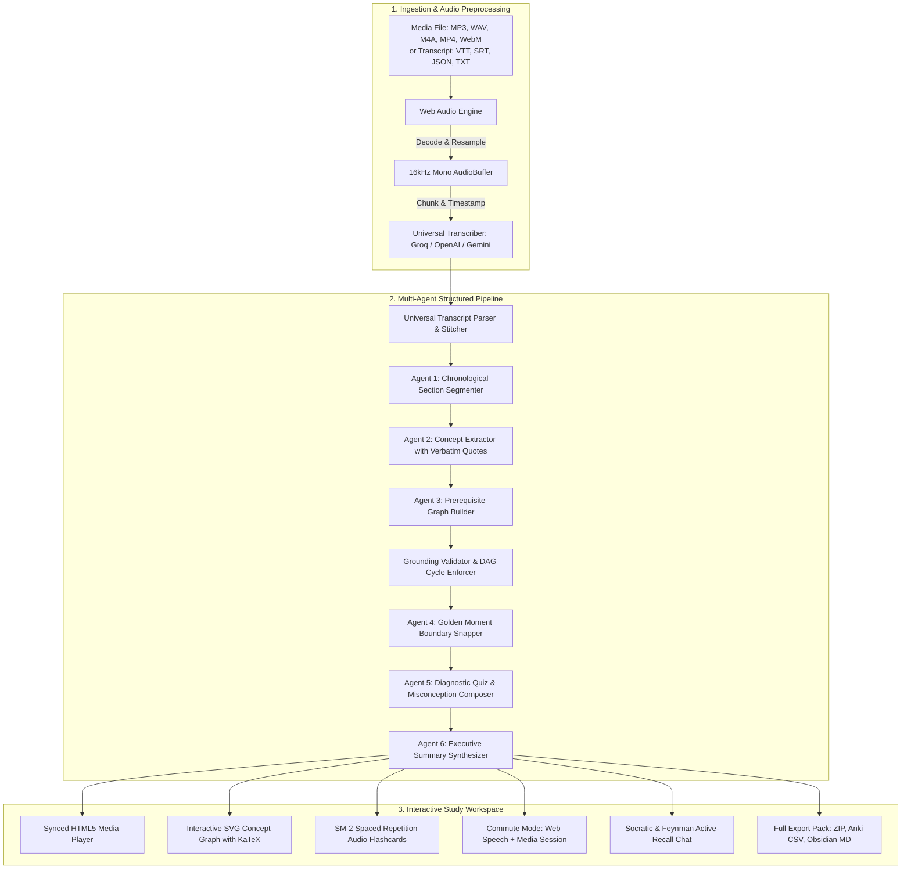

# 🎓 Lecture-to-Learning Generator (Lecture-Summariser)

[](https://www.typescriptlang.org/)
[](https://opensource.org/licenses/MIT)
[](https://nextjs.org/)
[](tests/)
[](#-zero-trust-privacy--security-model)

> **A real multimodal learning pipeline that transforms recorded lectures (video, audio, or transcripts) into interactive study systems: interactive prerequisite concept graphs, verbatim-grounded SuperMemo SM-2 audio flashcards with hands-free Commute Mode, diagnostic misconception quizzes, Socratic/Feynman active recall coaching, and a 1-click comprehensive Export Pack.**

---

## ⚡ What Makes This Real: Zero Fake Data

Unlike typical AI toy apps that ship hard-coded canned outputs or display bullet summaries, **Lecture-Summariser** is an end-to-end operational learning engine:

1. **Clean Slate by Default:** The application launches to a clean, production **Empty State** ready for your own media or transcript. No fake demo data is pre-selected.
2. **Strict Verbatim Grounding:** Every extracted concept, definition, and breakthrough moment requires a literal verbatim quote verified against the transcript. If an LLM hallucination occurs, the grounding engine flags or rejects it.
3. **Strict DAG Cycle Detection:** Prerequisite relationships between concepts are checked against topological cycle detection (`enforceDAG`). Back-edges are broken systematically to ensure a mathematically valid Directed Acyclic Graph (DAG).
4. **Client-Side Web Audio Slicing:** Breakthrough moments (~20–45 seconds) are snapped to real sentence boundaries and sliced into real `.wav` audio clips using the browser's native Web Audio API.
5. **SuperMemo SM-2 Spaced Repetition:** Flashcards are scheduled using the battle-tested SuperMemo SM-2 algorithm (`Again`, `Hard`, `Good`, `Easy`) tracking intervals, repetitions, and ease factors.
6. **Hands-Free Commute Mode:** Turn study time into a walk or drive with automated Text-to-Speech question prompts, silent recall pauses, original professor audio clip playback, takeaway narration, and Media Session API support for headphone/lock screen controls.
7. **Production Export Pack:** Generates a real ZIP archive containing sliced audio clips (`clips/*.wav`), `cards.json`, `concept-graph.json`, `transcript.vtt`, `summary.md`, and an Anki-compatible CSV file.

---

## 🏗️ Multi-Agent Architecture



---

## 🔑 Universal BYO API & Zero-Trust Privacy

The application requires **zero server-side database accounts** and stores **no API keys on any remote server**. 

### Supported Providers & Models

| Provider | Supported Models | Recommended Use Cases |
| :--- | :--- | :--- |
| **Google Gemini** | `gemini-2.0-flash`, `gemini-1.5-pro` | Multimodal transcription & fast concept extraction |
| **OpenAI** | `gpt-4o`, `gpt-4o-mini`, `whisper-1` | High-fidelity extraction & Whisper audio transcription |
| **Groq** | `whisper-large-v3`, `llama-3.3-70b-versatile` | Ultra-fast transcription (<5s) & open-weights inference |
| **Anthropic** | `claude-3-5-sonnet-20241022` | Deep Socratic analysis & diagnostic misconception design |
| **OpenRouter** | Any OpenRouter endpoint model | Flexible multi-model routing across providers |
| **Custom / Ollama** | Any local OpenAI-compatible endpoint (`http://localhost:11434/v1`) | 100% offline local inference |
| **In-Browser Local** | Client simulation engine | Offline exploration without external API calls |

### Zero-Trust Privacy Model
- **Storage:** Keys are stored in browser `sessionStorage` (cleared when the browser tab closes) or client-side encrypted `localStorage` (opt-in).
- **Network:** Requests to Gemini and OpenAI communicate directly with official provider endpoints via browser `fetch`. For providers lacking browser CORS headers (Anthropic, Groq, Ollama), calls route through a stateless CORS proxy (`/api/proxy`) that forwards the user's headers without caching, logging, or storing keys.

---

## 📦 Complete Study Export Pack

Clicking **"Export Pack (ZIP)"** produces a real, fully organized archive:

```
lecture-export-[slug].zip
├── clips/                     # Real .wav audio clips of golden breakthrough moments
│   ├── clip_001.wav           # Sliced via Web Audio API (16kHz mono)
│   └── clip_002.wav
├── cards.json                 # Flashcards with SM-2 state, front/back, takeaways
├── concept-graph.json         # Topological DAG nodes, KaTeX formulas, prerequisite edges
├── transcript.vtt             # Standard WebVTT with verified segment timestamps
├── summary.md                 # Executive summary, core equations, key takeaways
└── anki_cards.csv             # Importable Anki deck linking to sound clips
```

Additionally, users can export directly to **Obsidian Vault Markdown** (with YAML frontmatter, LaTeX equations, and callout blocks) or a **Printable Study Sheet**.

---

## 🧪 Test Suite & Verification

The engine includes 18 unit and integration tests covering all critical algorithms:

```bash
# Run unit & integration tests
npm test

# Run strict TypeScript type check
npm run typecheck

# Run Next.js production Turbopack build
npm run build
```

### Verified Test Matrix
- **`tests/grounding.test.ts`**: Verifies exact and normalized verbatim quote grounding, rejects ungrounded hallucinations, snaps golden moments to segment boundaries, and breaks DAG cycles while preserving acyclic edges.
- **`tests/sm2.test.ts`**: Validates SuperMemo SM-2 interval expansion, ease factor decay on difficulty, and interval reset to 1 day on recall failure (`again`).
- **`tests/transcriptParser.test.ts`**: Verifies SubRip (`.srt`) parsing, WebVTT (`.vtt`) parsing, millisecond timestamp normalization, and multi-chunk transcript deduplication.
- **`tests/pipeline.test.ts`**: Validates Zod schema parsing for concepts, golden breakthrough moments, and misconception quizzes, and verifies that `buildExportPackZip` creates valid ZIP archives containing all required study assets.

---

## 🚀 Getting Started

### Prerequisites
- Node.js 18+ or 20+
- npm or yarn

### 1. Installation
```bash
git clone https://github.com/patro15064-png/Lecture-Summariser.git
cd Lecture-Summariser
npm install
```

### 2. Development Server
```bash
npm run dev
```
Open [http://localhost:3000](http://localhost:3000) in your browser.

### 3. Usage Flow
1. **Empty State:** On initial launch, you will see the modern upload workspace.
2. **API Setup:** Click the **API Settings** key icon in the top header to enter your API key for Groq, Gemini, OpenAI, or Anthropic. (Or click **"Load Sample Walkthrough"** to explore an end-to-end verified lecture).
3. **Upload Lecture:** Click **"Upload Lecture"** or drop an audio file (`.mp3`, `.wav`), video file (`.mp4`), or transcript file (`.vtt`, `.srt`, `.txt`).
4. **Interactive Graph:** Explore the generated DAG concept map. Click any node to jump the media player to that point.
5. **Flashcards & Commute Mode:** Practice with the 3D cards, rate your recall using SM-2, or plug in your headphones and toggle **Commute Mode** for automated hands-free audio study.
6. **Export:** Click **"Export Pack"** to download your complete study zip with real audio clips.

---

## 📄 License

This project is licensed under the MIT License - see the [LICENSE](LICENSE) file for details.
